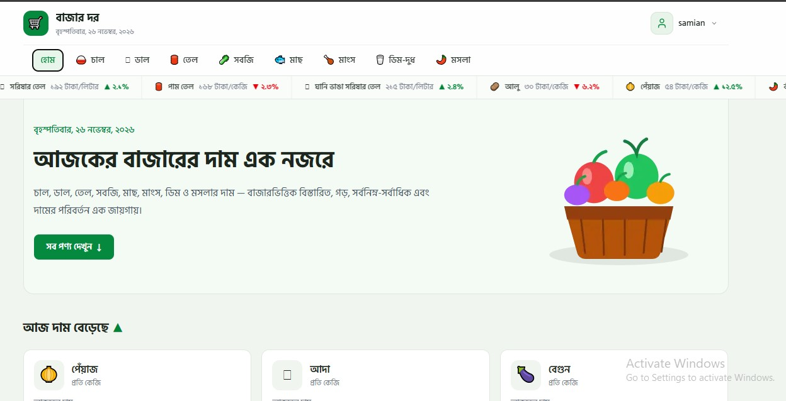

# বাজার দর — BazarDor

A Bengali-first daily market price dashboard built with Next.js 16. It shows live commodity prices, price movement, category-wise listings, and protected product details using the official BazarDor API from Programming Hero.

## Screenshots

### Homepage



## Live Website

[https://bazar-dor-seven-eosin.vercel.app/](https://bazar-dor-seven-eosin.vercel.app/)

---

## Features

1. **Live market data** — All products, categories, and market tables come from the official [BazarDor API](https://openapi.programming-hero.com/api/bazardor). No fake product data is stored in the app.
2. **Figma-matched navbar** — Logo and Bengali date, second-row category navigation with active highlighting, authentication/profile actions, and an infinite price ticker.
3. **Hero banner** — Eyebrow text, headline, subtitle, a green CTA that scrolls to `#সব-পণ্য`, and responsive hero artwork.
4. **Product sections** — Top 6 price risers, top 6 price fallers, and all products in a responsive card grid.
5. **Shared product card** — Emoji, Bengali name, unit line, today's price in Bengali digits, and green/red/gray change badge. Every card links to its slug-based detail page.
6. **Product details** — Protected `/product/[slug]` route with summary, minimum/maximum/average price cards, and a market-wise price table.
7. **Category pages** — Live category header, exact Bengali sort options, numeric sorting, loading skeletons, empty state, and friendly 404 handling.
8. **Authentication** — BetterAuth email/password plus Google and GitHub sign-in, toast feedback, protected profile routes, and a separate name-update page.
9. **Bengali formatting** — Prices, counts, percentages, and the current date use `Intl.NumberFormat("bn-BD")` and `Intl.DateTimeFormat("bn-BD")`.
10. **Responsive and resilient** — Mobile, tablet, and desktop layouts, reduced-motion support, global loading states, and a reusable 404 page.

---

## Technologies

| Area | Technology |
| --- | --- |
| Framework | Next.js 16 (App Router, Cache Components, Partial Prerendering) |
| Language | TypeScript |
| Styling | Tailwind CSS 4 |
| Authentication | BetterAuth with MySQL (`mysql2`) |
| Notifications | `react-hot-toast` |
| Fonts | `next/font/google` with Hind Siliguri |
| Lint / Types | ESLint 9, TypeScript 5 |
| Data Source | Official BazarDor live REST API |

---

## Routes

| Route | Description |
| --- | --- |
| `/` | Hero, top risers, top fallers, and all live products |
| `/category/[slug]` | Products for one live category, with sorting |
| `/product/[slug]` | Login-required product and market-price details |
| `/signin` | Email/password and social sign-in |
| `/signup` | Email/password and social registration |
| `/profile` | Protected account overview and sign-out |
| `/profile/update` | Protected BetterAuth `updateUser()` form |
| Unknown routes | Friendly 404 with `হোম পেজে ফিরে যান` |

---

## Getting Started

### Prerequisites

- Node.js 20+
- npm
- A MySQL database reachable from the app for BetterAuth

### Installation and Setup

Clone the repository and install dependencies:

```bash
git clone https://github.com/tosamia/BazarDor.git
cd BazarDor
npm install
```

Copy the example environment file:

```bash
cp .env.example .env.local
```

Configure your environment variables in `.env.local`, then start the development server:

```bash
npm run dev
```

Open [http://localhost:3000](http://localhost:3000) in your browser.

### Environment Variables

Copy `.env.example` to `.env.local` and configure the following variables:

| Variable | Required | Purpose |
| --- | --- | --- |
| `BETTER_AUTH_SECRET` | Yes | Secret used by BetterAuth to sign tokens |
| `BETTER_AUTH_URL` | Yes | Full app origin used by BetterAuth |
| `NEXT_PUBLIC_APP_URL` | Yes | Browser-visible app origin used by the auth client |
| `MYSQL_HOST` | Yes | MySQL host |
| `MYSQL_PORT` | Yes | MySQL port, usually `3306` |
| `MYSQL_USER` | Yes | MySQL user |
| `MYSQL_PASSWORD` | Yes | MySQL password |
| `MYSQL_DATABASE` | Yes | MySQL database name |
| `GOOGLE_CLIENT_ID` | Optional | Enables the Google social button |
| `GOOGLE_CLIENT_SECRET` | Optional | Enables the Google social button |
| `GITHUB_CLIENT_ID` | Optional | Enables the GitHub social button |
| `GITHUB_CLIENT_SECRET` | Optional | Enables the GitHub social button |

Generate a local secret with:

```bash
openssl rand -base64 32
```

> **Important:** `.env.local` is ignored by Git. Never put real credentials in `.env.example`, README files, logs, or commits.

---

## Scripts

| Command | Description |
| --- | --- |
| `npm run dev` | Start the development server |
| `npm run build` | Create a production build |
| `npm run start` | Serve the production build |
| `npm run lint` | Run ESLint |
| `npx tsc --noEmit` | Type-check without emitting files |

---

## Live API

**Base URL:**

```text
https://openapi.programming-hero.com/api/bazardor
```

**Used endpoints:**

```text
/products
/products?category=chal
/products/1
/categories
/categories/chal
```

The shared helpers in `src/lib/api.ts` normalize and type the API response, then cache it with Next.js Cache Components (`use cache: remote`, `cacheLife`, and `cacheTag`). Product detail slugs are resolved through `/products`, and full details are fetched by numeric ID.

---

## Verification and Deployment

See [`DEPLOYMENT.md`](./DEPLOYMENT.md) for the production build, route smoke-test results, environment setup, and Vercel deployment steps.

The project is a standard Next.js App Router application. Dynamic `[slug]` routes work on refresh without requiring additional rewrites.

## Live Deployment

**Production URL:** [https://bazar-dor-seven-eosin.vercel.app/](https://bazar-dor-seven-eosin.vercel.app/)

**GitHub Repository:** [https://github.com/tosamia/BazarDor](https://github.com/tosamia/BazarDor)
